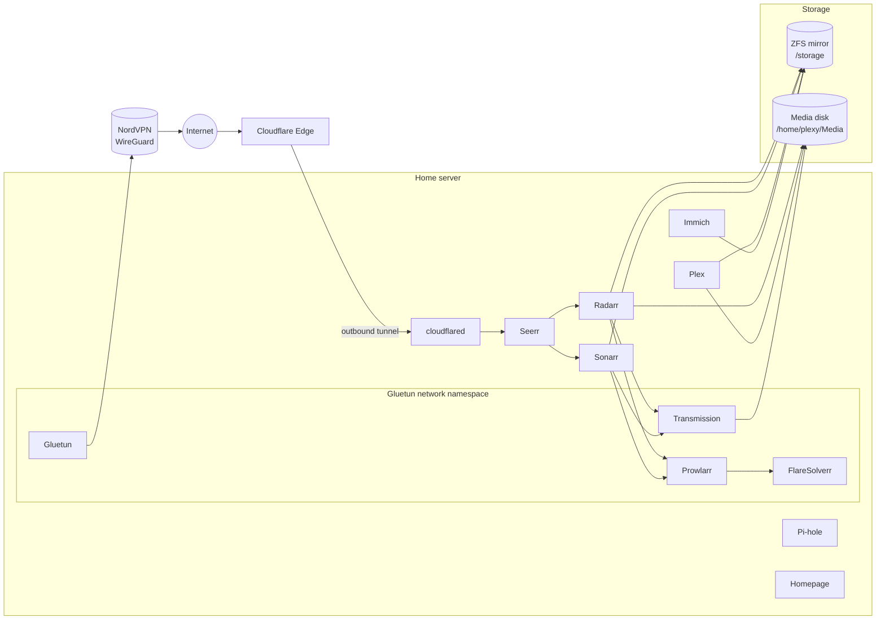

# homelab

Docker Compose configuration for my self-hosted home server: a media stack with
automated library management, a VPN-isolated download pipeline, photo backup,
network-wide ad blocking, and a Cloudflare Tunnel that lets friends request
media through Seerr.

The server runs headless Debian 13 with Docker. Every service is its own
Compose stack, secrets live in per-stack `.env` files that are never committed,
and a weekly cron job keeps the OS and all containers up to date.

## Services

| Stack | Service | Port | Purpose |
| --- | --- | --- | --- |
| `plex` | Plex | 32400 | Media server for movies and TV |
| `radarr` | Radarr | 7878 | Movie library management |
| `sonarr` | Sonarr | 8989 | TV library management |
| `overseerr` | Seerr | 5055 | Media requests for users |
| `gluetun` | Gluetun | — | WireGuard VPN gateway (NordVPN) |
| `gluetun` | Prowlarr | 9696 | Indexer manager, routed through the VPN |
| `gluetun` | Transmission | 9091 | Torrent client, routed through the VPN |
| `gluetun` | FlareSolverr | 8191 | Cloudflare challenge solver for indexers, routed through the VPN |
| `immich` | Immich | 2283 | Photo and video backup (with Postgres and Redis) |
| `pihole` | Pi-hole | 80, 53 | Network-wide DNS ad blocking |
| `homepage` | Homepage | 3000 | Dashboard for all services |
| `cloudflared` | Cloudflare Tunnel | — | Exposes Seerr to friends without opening ports |

## Architecture



### Request and download flow

1. A user requests a movie or show in **Seerr**, which hands it to **Radarr**
   (movies) or **Sonarr** (TV).
2. Radarr/Sonarr search through **Prowlarr**, which queries the indexers and
   uses **FlareSolverr** for sites behind Cloudflare challenges.
3. The chosen release is sent to **Transmission**, which downloads it into
   `Pending`.
4. Radarr/Sonarr import the finished download into the library, and **Plex**
   picks it up.

### Network isolation

Prowlarr, Transmission and FlareSolverr use `network_mode: service:gluetun`.
They share Gluetun's network stack, so all of their traffic leaves through the
WireGuard tunnel. If the VPN drops, they have no route to the internet: there
is no fallback to the home connection. Their web UIs are published through
Gluetun's port mappings, and `FIREWALL_OUTBOUND_SUBNETS` allows them to reach
the LAN.

Plex, Seerr and Pi-hole use host networking. Plex needs it for local discovery,
and Pi-hole needs it to serve DNS on port 53 for the whole network.

### External access

Friends who have access to the Plex library request new movies and shows
through Seerr, so Seerr is the one service published to the internet.
`cloudflared` opens an outbound tunnel to Cloudflare, and a public hostname in
the Cloudflare Zero Trust dashboard routes to Seerr on port 5055. No inbound
port needs to be opened for it. Users sign in to Seerr with their Plex account.

Everything else, including the admin tools (Radarr, Sonarr, Prowlarr,
Transmission, Homepage, Pi-hole), is only reachable on the local network.

### Storage

| Path | Backing | Contents |
| --- | --- | --- |
| `/storage/shows` | ZFS mirror dataset | TV shows |
| `/storage/photos` | ZFS mirror dataset | Immich library |
| `/storage/movies` | ZFS mirror dataset | Movie overflow |
| `/home/plexy/Media` | Single ext4 disk | Movies, other libraries, `Pending` downloads |
| `/opt/docker/<service>` | OS SSD | Application config and databases |

The ZFS pool `storage` is a two-disk mirror, so the main libraries survive a
single drive failure. Application state lives in `/opt/docker` and is **not**
part of this repository. Back it up separately.

## Repository layout

```
.
├── <stack>/
│   ├── docker-compose.yml
│   └── .env.example        # required variables; copy to .env
├── scripts/
│   ├── update.sh                   # weekly OS + container update
│   ├── homelab-update.cron         # cron schedule (Tuesdays 03:00)
│   ├── homelab-update.logrotate    # log rotation for update.sh
│   └── docker-zfs.conf             # systemd drop-in: Docker waits for ZFS
└── README.md
```

## Installation

### 1. Base system

Install Debian 13 and log in as a user with UID/GID 1000 (the stacks use
`PUID=1000`/`PGID=1000`). This repo assumes the user is `plexy`. If yours is
different, update the `/home/plexy` paths in the compose files and in
`scripts/homelab-update.cron`.

Install Docker Engine with the Compose plugin
([docs](https://docs.docker.com/engine/install/debian/)), then:

```bash
sudo usermod -aG docker $USER
```

### 2. Storage

Install ZFS (needs the `contrib` component enabled in APT sources) and create
the mirrored pool and datasets:

```bash
sudo apt install linux-headers-amd64 zfs-dkms zfsutils-linux

# Use stable /dev/disk/by-id paths, not /dev/sdX
sudo zpool create -o ashift=12 storage mirror \
    /dev/disk/by-id/<disk-1> /dev/disk/by-id/<disk-2>
sudo zfs create storage/shows
sudo zfs create storage/photos
sudo zfs create storage/movies
sudo chown -R 1000:1000 /storage/shows /storage/photos /storage/movies
```

Make Docker wait for the ZFS datasets at boot so containers never start
against empty mount points. Run this from the cloned repo (step 3), or come
back to it after cloning:

```bash
sudo install -Dm644 scripts/docker-zfs.conf \
    /etc/systemd/system/docker.service.d/override.conf
sudo systemctl daemon-reload
```

The drop-in checks that each dataset is really mounted
(`AssertPathIsMountPoint=`) when Docker is about to start. Depending on
`zfs-mount.service` isn't enough, because it reports success even when the
pool failed to import. `RequiresMountsFor=` doesn't work either: ZFS mounts
have no fstab entry, so systemd only orders after them and silently drops the
dependency when they don't exist. After a power cut the HBA once failed to
initialise, the pool didn't import, and Docker started every container against
empty `/storage` folders on the OS SSD. Now a missing dataset makes Docker
fail to start (`systemctl status docker` shows the failed assertion). Fix the
pool (`sudo zpool import storage && sudo zfs mount -a`), then run
`sudo systemctl start docker`.

Create the media folders on the media disk:

```bash
mkdir -p ~/Media/{Movies,Pending,Skrípó,Teiknimyndir,Skripo}
sudo mkdir -p /opt/docker && sudo chown 1000:1000 /opt/docker
```

### 3. Clone and configure

```bash
git clone https://github.com/bjarkijoha/homelab.git ~/docker
cd ~/docker

# Create a .env for every stack that needs one, then fill in real values
for f in */.env.example; do cp -n "$f" "${f%.example}"; done
chmod 600 */.env
```

| Stack | Variables |
| --- | --- |
| `gluetun` | `WIREGUARD_PRIVATE_KEY` (from your NordVPN WireGuard credentials), `TRANSMISSION_USER`, `TRANSMISSION_PASS` |
| `cloudflared` | `TUNNEL_TOKEN` (Zero Trust → Networks → Tunnels → create tunnel) |
| `immich` | `DB_PASSWORD` and the other database settings |
| `pihole` | `PIHOLE_PASSWORD` (admin password; Pi-hole won't start if it's empty) |

If you are restoring an existing server, restore `/opt/docker` from backup
**before** starting the stacks so every service comes back with its settings.

### 4. Start the stacks

Start Pi-hole first (DNS), then the VPN stack, then everything else:

```bash
cd ~/docker
for stack in pihole gluetun plex radarr sonarr overseerr immich homepage cloudflared; do
    docker compose -f "$stack/docker-compose.yml" up -d
done
```

Check that the VPN is up and download traffic leaves through it:

```bash
docker logs gluetun | grep -i "public ip"
```

### 5. Connect the services

On a fresh install, wire the apps together in their web UIs:

- **Prowlarr**: add indexers and FlareSolverr (`http://localhost:8191`, since it
  shares Prowlarr's network namespace), then add Radarr and Sonarr as apps.
- **Radarr / Sonarr**: add Transmission as the download client (host
  `192.168.1.110`, port `9091`). Set root folders (`/movies`, `/movies-overflow`,
  `/shows`).
- **Seerr**: sign in with Plex and connect Radarr and Sonarr.
- **Plex**: add the libraries from `/Movies`, `/Shows` and the other mounted folders.
- **Cloudflare**: in the tunnel's settings, add a public hostname that points to
  Seerr (`http://192.168.1.110:5055`).

### 6. Automatic updates

`scripts/update.sh` upgrades OS packages, installs matching kernel headers,
and checks that the ZFS kernel module is built for the newest kernel, so the
pool will import after a reboot. It then
pulls new images for every stack, recreates changed containers, prunes old
images, and reboots if the update requires it. The reboot is skipped if the ZFS
module is missing.

```bash
sudo cp scripts/homelab-update.cron /etc/cron.d/homelab-update
sudo cp scripts/homelab-update.logrotate /etc/logrotate.d/homelab-update
```

It runs every Tuesday at 03:00 and logs to `/var/log/homelab-update.log`. To
run it by hand without rebooting:

```bash
sudo ~/docker/scripts/update.sh --no-reboot
```
